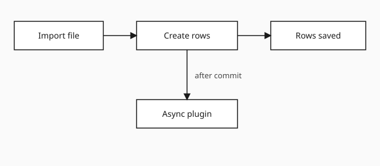

The import job created thousands of records in one transaction. A synchronous plugin on Create ran for every row, and the platform cancelled the job when the step passed the two-minute limit.

The plugin itself was small. It looked up a parent account and wrote two fields. On a single form save that is fine. On a bulk import it ran once per row, inside the same transaction as the import.

## What failed

Dataverse executes a synchronous plugin on the pipeline of the message that triggered it. The import stays open until every step returns. One slow lookup, repeated thousands of times, is enough to hit the timeout. The whole batch rolls back, including the rows that had already succeeded.

## What fixed it

Move the work off the import transaction:

1. Register the plugin step as asynchronous, on Create.
2. Keep the import itself free of lookups.
3. Let the system job fill in the two fields after the row exists.



The async job can fail on one row without undoing the import. Those failures show up in System jobs, which is easier to retry than a rolled-back file.

## The step that stayed synchronous

A short guard still runs in the pre-operation stage. It only rejects a row when a required key is missing. No queries.

```csharp
if (string.IsNullOrWhiteSpace(target.GetAttributeValue<string>("new_importkey")))
{
    throw new InvalidPluginExecutionException("Import key is required.");
}
```

Replace this sample with your own note. Copy the folder, change the title, date, and summary, and drop a schema or flow image next to `index.md`.
